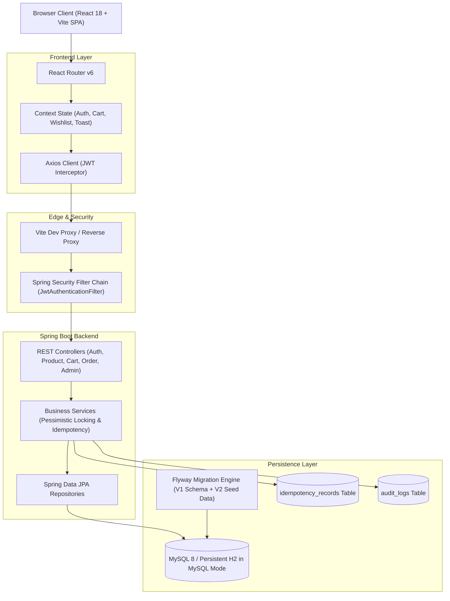
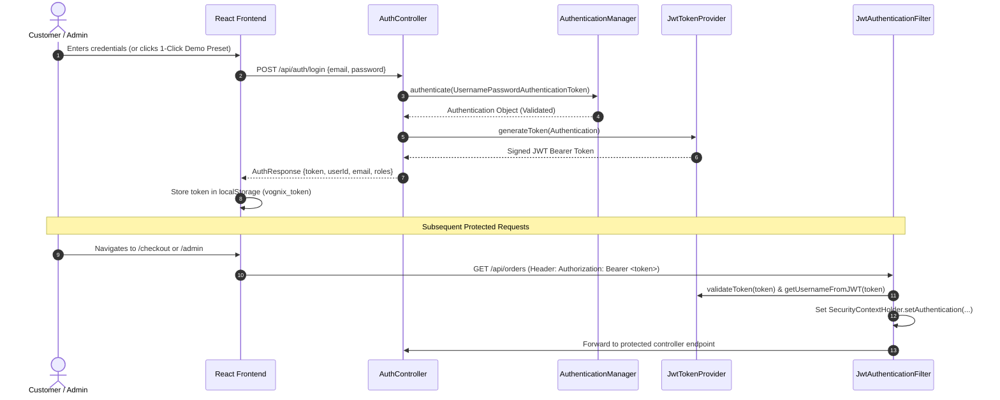
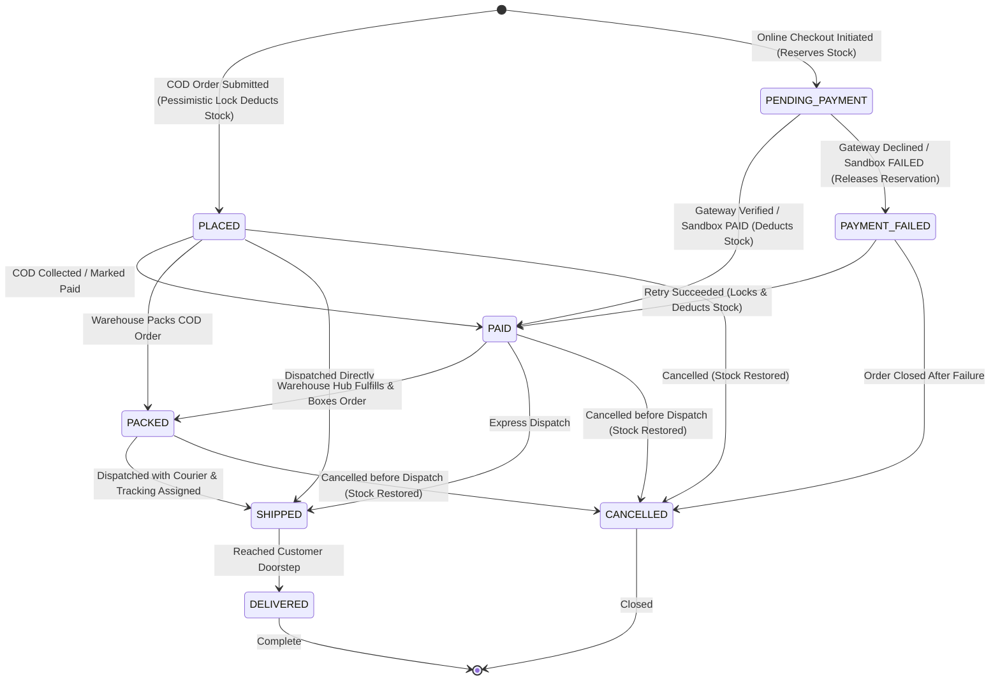
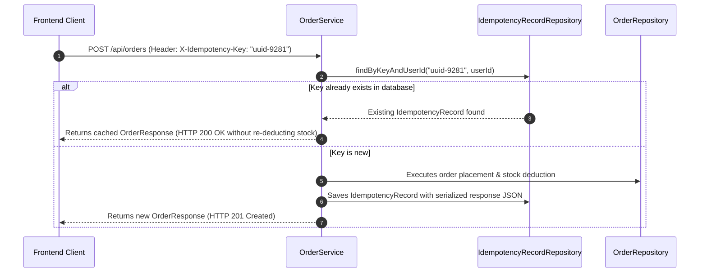

# VOGNIX – System Architecture & Engineering Specifications

This document outlines the software design patterns, security model, concurrency controls, idempotency mechanisms, and state machines implemented in the **VOGNIX** platform.

---

## 1. High-Level Architecture Diagram



---

## 2. Authentication & Authorization Flow

VOGNIX implements a stateless, token-based authentication mechanism using **JSON Web Tokens (JWT)** via JJWT `0.12.5` and Spring Security 6.



---

## 3. Order Lifecycle State Machine

The order lifecycle follows an explicit state transition machine. Only valid transitions are permitted, and cancellation triggers automated inventory restorations inside transactional boundaries.



### State Transition Validation Table:

| Current Status | Permitted Next Statuses | Invariant / Side Effect |
| :--- | :--- | :--- |
| `PENDING_PAYMENT` | `PAID`, `PAYMENT_FAILED` | Stock reserved until payment resolves; cannot be cancelled while pending |
| `PAYMENT_FAILED` | `PAID`, `CANCELLED` | Reservation released; retry re-validates & deducts stock |
| `PLACED` | `PAID`, `PACKED`, `SHIPPED`, `CANCELLED` | COD order placed with inventory already deducted via pessimistic lock |
| `PAID` | `PACKED`, `SHIPPED`, `CANCELLED` | Payment confirmed in `payments` table |
| `PACKED` | `SHIPPED`, `CANCELLED` | Order boxed and labeled at warehouse |
| `SHIPPED` | `DELIVERED` | Handed over to logistics carrier |
| `DELIVERED` | None (Terminal) | Final fulfilled state |
| `CANCELLED` | None (Terminal) | Atomic rollback: stock restored to `inventory` |

---

## 4. Concurrency Control: Atomic Stock Reservation

To prevent overselling when multiple customers check out the same limited-stock variant concurrently, VOGNIX utilizes **JPA Pessimistic Write Locking** (`LockModeType.PESSIMISTIC_WRITE`).

### Implementation Details:
```java
@Repository
public interface InventoryRepository extends JpaRepository<Inventory, Long> {
    
    @Lock(LockModeType.PESSIMISTIC_WRITE)
    @Query("SELECT i FROM Inventory i WHERE i.variant.id = :variantId")
    Optional<Inventory> findByVariantIdWithLock(@Param("variantId") Long variantId);
}
```

1. During `orderService.placeOrder(...)`, the database issues a `SELECT ... FOR UPDATE` row lock on the specific variant's inventory row.
2. The transaction inspects `stockQuantity >= requestedQuantity`.
3. If stock is insufficient, an `InsufficientStockException` is thrown, and Spring aborts the transaction immediately.
4. If stock is sufficient, the inventory is deducted and saved before releasing the row lock, guaranteeing zero negative inventory.

---

## 5. Network Failure & Double-Charge Protection: Idempotency Pattern

To guarantee that network timeouts, double clicks, or browser retries never place multiple orders or charge a card twice, VOGNIX supports client-generated `X-Idempotency-Key` headers.



---

## 6. Audit Trail Architecture

All administrative changes and high-impact operations are captured in the `audit_logs` table via `AuditLogService.logAction(...)`.

Each record captures:
- `user_id` & `user_email`: The actor initiating the action.
- `action_type`: Standardized event constant (e.g. `PRODUCT_CREATED`, `ORDER_STATUS_UPDATED`, `INVENTORY_STOCK_UPDATED`, `COUPON_CREATED`).
- `entity_name` & `entity_id`: The domain entity affected (e.g. `Product`, `Order`, `Inventory`).
- `details`: Human-readable JSON or description of the modification.
- `ip_address`: Network IP address recorded from the HTTP servlet request.
- `created_at`: High-precision timestamp.
